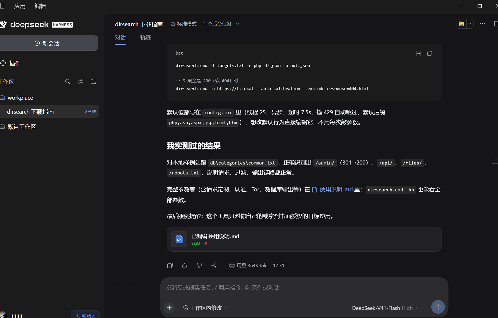

# 25\-web\-好名字给狗取了\-10\.28

# Web 方向 week1 作业

# [\[SWPUCTF 2021新生赛\]gift\_F12](https://www.nssctf.cn/problem/382)

F12控制台元素中就有flag

WLLMCTF\{We1c0me\_t0\_WLLMCTF\_Th1s\_1s\_th3\_G1ft\}

# [\[qsnctf\-NO\.0902\]robots\.txt](https://www.qsnctf.com/#/main/driving-range?page=1&category=&difficulty=&keyword=robots.txt)

> 上面说"用dirsearch扫一下路由看看"
> 
> 

让deepseek直接下载dirsearch

使用它

结果

打开网站

找到密码账号

登录

flag\{10f3d814a39346319a560cc38a783a47\}

# [\[MoeCTF 2021\]Web安全入门指北—GET](https://www.nssctf.cn/problem/3412)

代码要GET一个moe,当moe=flag输出flag

NSSCTF\{1df7f4ba\-01fc\-42ba\-b261\-9118a5c5ffae\}

参考HTTP文档https://developer.mozilla.org/zh-CN/docs/Web/HTTP/Guides/Overview

