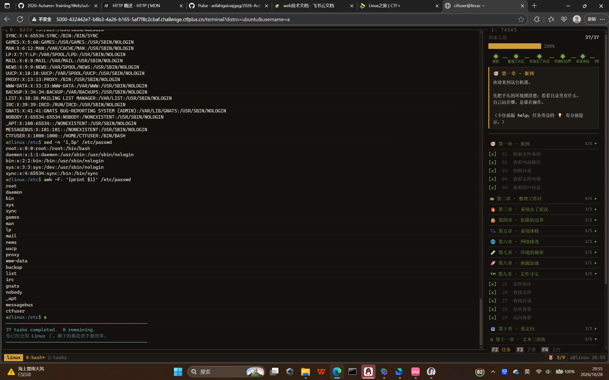

# 25\-web\-好名字给狗取了\-10\.28

# Web 方向 week2 作业

# [pkwctf2026\-Linux之旅](https://www.ctfplus.cn/problem-detail/2105939188284133376/description)

第一章

> ls查看当前目录
> 
> pwd查看当前地址
> 
> cd /\.\.\.切换目录
> 
> cat /\.\.\.查看文件
> 
> whoami查看当前用户
> 
> 

第二章

> mkdir /\.\.\.创建目录
> 
> touch \<文件名\>创建文件
> 
> cp \<源\> \<目标\>复制文件
> 
> rm \<文件名\>删除文件
> 
> 

第三章

head \<文件名\>查看文件前十行

tail \<文件名\>查看文件后十行

grep \<词\> \<文件\>在文件中搜索词

第四章

> ls \-la    查看文件权限
> 
> chmod \<数字\> \<地址\>修改文件权限
> 
> r=4，w=2，x=1
> 
> 每一位是 u \(所有者\)、g \(同组\)、o \(其他人\)
> 
> 755 rwxr\-xr\-x 目录、脚本，最常用目录权限
> 
> 

忘记截图了

第五章

uname        不加参数，只输出系统名称 Linux

uname \-a   【最常用】全部信息：内核版本、主机名、架构、发行时间

df                查看磁盘空间,默认输出，单位KB，不好读

df \-h            最常用！自动用 G/M/K 单位\(\-h指让人类方便阅读\)

free\(\-h\)            查看内存使用

ps \-sux     查看进程

- `a`：显示所有用户的进程

- `u`：以用户友好格式展示（CPU、内存、用户）

- `x`：展示无终端的后台守护进程

pgrep \<名字\>   查找进程 

第六章

ip addr 查看网络接口和IP地址信息

ping \<主机\>查看网络连通性

第七章

env   查看环境变量

echo PATH 查看PATH环境变量

第八章

第九章

wc \<文件名\>  统计文件的行数  单词数  字节数

> find \[搜索起始路径\] \[匹配条件\] 查找文件
> 
> - `-type f` 只搜**文件 file**
> 
> - `-type d` 只搜**目录 directory**
> 
> 从根目录全盘搜索名字带flag的文件（CTF最常用） find / \-name "\*flag\*"
> 
> 

> more    分页查看文本文件\(不能回退,less可以回退\)
> 
> - 空格：**向下翻一整页**
> 
> - Enter：向下翻**一行**
> 
> - `q`：退出
> 
> - `b`：向上翻页（部分版本支持）
> 
> 

tac cat的反向拼写,也是输出,不过是从后往前输出

第十章

echo hello \> test\.txt  将 hello 写入 test\.txt，如果test\.txt存在，直接覆盖 

\>\>是向后追加,不会覆盖

第十一章

sort \<文件名\> 排序

- `-r`：reverse，**倒序（从大到小）**

- `-n`：numeric，**按数字大小排序**（重点！默认是字典排序，数字会排错）

- `-u`：unique，**去重**，相同行只保留一条

- `-k`：指定第几列排序

cut \[参数\] 文件   按分隔符截取一行里的某一列 / 一段字符

- `-d`：指定分隔符（delimiter），默认是制表符 `\t`

- `-f`：取第几列（field）

- `-c`：按**字符位置**截取

> tr  字符转换、替换、删除字符
> 
> tr 'a\-z' 'A\-Z' \< \<文件\> 小写变大写
> 
> sed 流编辑器，**按行处理文本、正则替换**
> 
> `p`：print，打印
> 
> `1,5`：行范围，**第 1 行 到 第 5 行**
> 
> `s/old/new/g`  替换
> 
> `i` 删除
> 
> 

> awk
> 
> awk \-F ":" '\{print $1\}' /etc/passwd  用冒号分隔，取第1列用户名
> 
> - `$0`：**整行全部内容**
> 
> - `$1`：第 1 列
> 
> - `$2`：第 2 列
> 
> - `$NF`：**最后一列**（NF = Number of fields，字段总数）
> 
> - `FS`：分隔符，默认**任意空白**
> 
> - 用 `-F "符号"` 修改分隔符，等价 `BEGIN{FS=":"}`
> 
> 

# 找flag

发现flag需要更高权限

查看文件权限

发现我这个用户没有权限修改

回去查找各个文件发现有提示

直接打开

乱码

看来是被过滤了

不能出现空格,flag

`${IFS}` —— 代替空格，绕过 no\-space

`/fl*` —— 通配符绕过 `flag`关键词检测

发现它要传一个参数作为ping的地址

所以我们`';cat${IFS}/fl*'`先传一个空白,然后分号后面的代码正常运行找到flag

flag：PKWCTF\{f5c9b90c\-624b\-4b58\-be9e\-a9a68921a279\}

