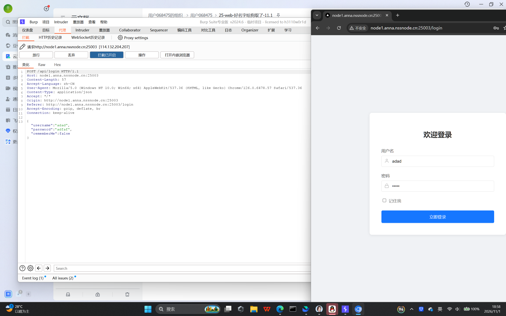

# 25\-web\-好名字给狗取了\-11\.1

# [\[LitCTF 2025\]nest\_js ](https://www.nssctf.cn/problem/6786)

这是ai给出的流程

> 汉化版完整步骤（直接照着点）
> 
> 1. **代理 → 拦截**，打开拦截开关（拦截：开启）
> 
> 2. 浏览器访问靶机登录页，账号填`admin`，密码随便输，点登录
> 
> 3. 抓到请求包，右键 → **发送到入侵者**
> 
> 4. 切到【入侵者 → 位置】 
> 
>     - 点 **清除标记**
> 
>     - 选中 password 后面的值 → **添加标记**，效果：`password=§随便的内容§`
> 
>     - 攻击类型选：**狙击手（Sniper）**
> 
> 5. 切到【载荷】 
> 
>     - 载荷集：1，载荷类型：**简单列表**
> 
>     - 点 **加载**，选中你的密码字典 txt
> 
> 6. 右上角 **开始攻击**
> 
> 7. 在攻击结果表里面找： 
> 
>     - 状态码是 302；或者长度和别的包不一样；响应里没有 “用户名或密码错误”
> 
> 8. 拿到密码，浏览器登录，访问 `/dashboard` 拿 flag
> 
> 



抓包

直接用admin试试


选择playload


选择密码


好像都失败了

可能用户名也要爆破


试试集束炸弹

用ai给的用户名弱口令字典 密码弱口令字典试试


第一个用用户名,第二个用密码


不一样的就是答案

admin  password

看来之前我用admin用户名,密码撞库也是成功了的只是我没有看到那个成功的状态码,用软件自带的密码字典太多了


# [\[SWPUCTF 2025 秋季新生赛\]DANGEROUS TRIAL](https://www.nssctf.cn/problem/7208)


抓包


配置playload,用户名和密码用集束炸弹


用常用的失败了


屏幕截图 2026-11-01 201543.png
发现www\.zip解压成hello\.txt

用这个字典爆破


由于太多了,就多用点资源池


还是好慢

最后答案是用户名amin密码MSSLOVE

## 一、一句话认识 JWT

**JWT 是一张"服务器签过字的身份证"**：用户登录成功后，服务器把用户信息写进一个 JSON 对象，自己加上防伪签名，把这个 JSON 交给客户端保存；之后客户端每次请求都带着它回来，服务器只靠签名就能确认身份——**服务器端不再保存任何 session 数据（无状态）**。

## 二、为什么要 JWT：跨域认证的老问题

### 2.1 传统的 Session 认证流程

1. 用户向服务器发送用户名和密码；
2. 服务器验证通过后，在当前 session 里保存相关数据（角色、登录时间等）；
3. 服务器返回 `session_id`，写进用户 Cookie；
4. 用户后续每次请求通过 Cookie 带回 `session_id`；
5. 服务器用 `session_id` 找回数据，得知用户身份。

### 2.2 问题：扩展性（scaling）差

- 单机没问题；但**服务器集群**或**跨域的服务导向架构**里，session 必须共享，每台服务器都要能读到。
- 典型场景：A 站与 B 站是同一家公司的关联服务，要求**一处登录、处处自动登录**。

### 2.3 两种解法对比


| 方案                  | 做法                                                   | 优点                                | 缺点                                     |
| --------------------- | ------------------------------------------------------ | ----------------------------------- | ---------------------------------------- |
| Session 持久化        | 把 session 写入数据库 / Redis 等持久层，各服务统一去读 | 架构清晰；可随时踢人、改权限        | 工程量大；持久层挂了就是**单点失败**     |
| **无状态令牌（JWT）** | 服务器不存 session，数据全放客户端，每次请求带回       | 无状态、易水平扩展、天然跨域/跨服务 | 无法吊销、体积大、泄露即失守（见第五节） |

> 记忆点：JWT 的核心取舍是**"把状态从服务端搬到客户端"**，用"签名"保证客户端改不了。

## 三、JWT 的数据结构（重点）

真实的 JWT 是一个**长字符串，内部没有换行**，用点 `.` 分成三段：

```
Header.Payload.Signature
  ↑        ↑         ↑
 头部     负载      签名
```

各部分都是 **Base64URL 编码后**的字符串。所以 JWT 看起来像：

```
eyJhbGciOiJIUzI1NiIsInR5cCI6IkpXVCJ9
.eyJzdWIiOiIxMjM0NTY3ODkwIiwibmFtZSI6IkpvaG4gRG9lIiwiYWRtaW4iOnRydWV9
.SflKxwRJSMeKKF2QT4fwpMeJf36POk6yJV_adQssw5c
```

### 3.1 Header（头部）— 描述元数据

```json
{
  "alg": "HS256",
  "typ": "JWT"
}
```


| 字段  | 含义                                                                    |
| ----- | ----------------------------------------------------------------------- |
| `alg` | 签名算法（algorithm），**默认 HS256**（HMAC SHA256），也可以是 RS256 等 |
| `typ` | 令牌类型（type），JWT 统一写 `JWT`                                      |

这个 JSON 对象用 **Base64URL** 转成字符串，就是第一段。

### 3.2 Payload（负载）— 实际要传的数据

除了官方 7 个字段，还可以自定义私有字段。**官方字段全部可选**（都是"claims/声明"）：


| 字段  | 全称            | 含义                               |
| ----- | --------------- | ---------------------------------- |
| `iss` | issuer          | 签发人                             |
| `exp` | expiration time | 过期时间                           |
| `sub` | subject         | 主题（通常是用户 ID）              |
| `aud` | audience        | 受众                               |
| `nbf` | Not Before      | 生效时间                           |
| `iat` | Issued At       | 签发时间                           |
| `jti` | JWT ID          | 编号（唯一 ID，可用于黑名单/幂等） |

自定义字段示例：

```json
{
  "sub": "1234567890",
  "name": "John Doe",
  "admin": true
}
```

> ⚠️ **JWT 默认不加密，Payload 只是 Base64URL 编码，任何人 Base64 解码就能看到内容**。所以：
>
> - 不要把密码、身份证号、密钥等**秘密信息**放进去；
> - "加密 ≠ 编码"，Base64 不是加密手段，只能算"防止肉眼直接看到"。

### 3.3 Signature（签名）— 防止篡改

签名是用**只有服务器知道的密钥 `secret`**，对"前两段"做 HMAC 运算得到的：

```javascript
HMACSHA256(
  base64UrlEncode(header) + "." + base64UrlEncode(payload),
  secret
)
```

- 签名覆盖的是 **`header.payload` 这段原始字符串**，不是解码后的 JSON；
- 客户端改了 Payload 的任何一位，服务器重新算出的签名就对不上 → 拒绝；
- 客户端知道算法也没用，因为**不知道 secret**。

最终拼接：`Header.Payload.Signature`，返回给用户。

### 3.4 Base64URL — 为什么不用普通 Base64

JWT 可能出现在 URL 里（如 `api.example.com/?token=xxx`），而标准 Base64 的 `+`、`/`、`=` 在 URL 中有特殊含义，所以：


| 标准 Base64 | Base64URL |
| ----------- | --------- |
| `+`         | `-`       |
| `/`         | `_`       |
| `=`（填充） | 直接省略  |

> 所以 JWT 里**不会出现 `+`、`/`、`=`**，只由 `A-Z a-z 0-9 - _ .` 组成。

---

## 四、JWT 的使用方式

### 4.1 客户端存哪里

- 存 **Cookie**：可自动发送，但**不能跨域**；
- 存 **localStorage**：跨域更灵活，但需要手动带在请求里（且更易受 XSS 影响）。

### 4.2 怎么带给服务器（推荐做法）

放在 HTTP 请求头 `Authorization` 字段，格式固定为 `Bearer` + 空格 + token：

```http
Authorization: Bearer <token>
```

```javascript
// 前端 fetch 示例
fetch("/api/profile", {
  headers: { Authorization: `Bearer ${token}` }
});
```

### 4.3 跨域场景

跨域时也可以把 JWT 放在 **POST 请求的数据体**里。
若真要走 Cookie 跨域，则需要服务端 `CORS` 配合 `Access-Control-Allow-Credentials: true`、`SameSite` 等设置（原教程未展开）。

---

## 五、JWT 的几个特点（含风险清单）

1. **JWT 默认不加密**，但可以加密——生成原始 Token 后，可用密钥再加密一次（如 JWE）。
2. 不加密时，**绝不能把秘密数据写进 JWT**。
3. JWT 不只用于认证，也可用于**信息交换**；有效使用可**减少服务器查库次数**（用户信息随请求带来）。
4. ⚠️ **最大缺点**：服务器不保存 session，因此**无法在使用过程中废止某个 token、或修改其权限**。一旦签发，**到期前始终有效**——除非服务器额外部署逻辑（如黑名单/白名单）。
5. ⚠️ 令牌本身包含认证信息，**一旦泄露，谁拿到谁拥有全部权限**。所以**有效期要短**；重要权限操作应**再次认证**。
6. ⚠️ **必须走 HTTPS**，不要用明文 HTTP 传输。
